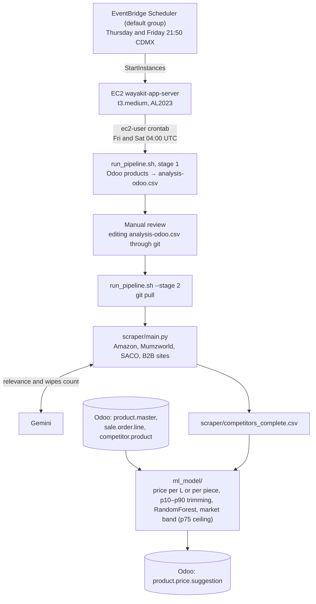

# Price Intelligence (PI)

Suggested prices for Wayakit's Saudi Arabia catalog. Competitor site scrapers → CSV → RandomForest model (scikit-learn) → `product.price.suggestion` in Odoo (previous suggestions are archived in `product.price.suggestion.history`). It runs on an EC2 in Wayakit's AWS account, region eu-north-1.

> **Odoo:** confirm the company (KSA or MX) before reading or writing. The reads **do not filter by company** (`ml_model/odoo_api_*.py`); the database is KSA only (Mafer, 2026-11-17). Since F2 the upload refuses to write if the Odoo user sees more than one company.

No credentials go in the repo, and no new CSVs or data are added: the only versioned CSVs are the 3 listed in "How to run it locally".

## Architecture today



- On the instance today (pre-F2 code, e25e2c9) the pipeline runs in two stages, each a separate start-up, and when each finishes the instance stops itself (`trap EXIT`, `run_pipeline.sh:52` in e25e2c9). They are launched by the `ec2-user` crontab (not in the repo): stage 1 on Friday 04:00 UTC and stage 2 (`--stage 2`) on Saturday 04:00 UTC (Thursday and Friday 22:00 CDMX). Starting the instance at any other time launches nothing. The run is always full: since e25e2c9 partial mode (new products only, in append) is disabled, although its code is still in that script.
- **Since F3 the code has no stages and no partial mode** (Mafer, 2026-11-18): `run_pipeline.sh` takes no arguments and runs everything in one go (see "F3" below). The diagram above is what the instance runs today.
- All state (CSVs, `.joblib` models, logs) lives only on the instance disk; the pre-F2 code also keeps the state files `run_mode.txt` and `last_full_run.txt`, which F3 no longer has. Since F2, logs go to one folder outside the code: `PI_LOG_DIR`, default `<repo>/../logs`. There is a manual snapshot from 2026-11-17 (`pi-f1-antes-inventario`).
- The instance runs the **`server-improvement`** branch (e25e2c9), one commit ahead of `main`. When this development is finished, **`main`** is the production branch (Mafer, 2026-11-18).
- The last full run (13–15 Nov 2026) failed in scraping (30 h timeout, 53 rows) and still uploaded suggestions to Odoo: today they come almost only from `competitor.product`.

### F2 changes (in the code, not yet on the instance)

- Every pipeline step aborts the run if it fails (`|| exit 1`), and every script exits with code 1 on an error. The pipeline no longer runs `git pull` (deploy by hand through SSM until F4) and no longer deletes `competitors_complete.csv`: the scraper replaces it only when it succeeds.
- Relevance with Amazon Bedrock (DeepSeek V3.2, fallback Claude Haiku 4.5) instead of Gemini, in batches, with the instance role. **It needs `bedrock:InvokeModel` on the instance role (F3) before it can run there.** The scraper writes a coverage report (`scraper/coverage_report.csv`).
- Safe upload to Odoo: `--dry-run`, create the new batch before deleting the previous one, `--cleanup-previous`, and a company guard.
- Sales from the last 12 rolling months; secrets read only through `pi_secrets.py`.

Details in [docs/runbook.md](docs/runbook.md) and [docs/decisions.md](docs/decisions.md).

### F3 (applied: 2026-11-18 and cutover 2026-11-22)

- `infra/`: one boto3 script per resource, idempotent, with `--dry-run`, run as `python -m infra.<name>` with the `wayakit-vdc` profile in eu-north-1: S3 bucket, a new least-privilege instance role (with Bedrock), scheduler role, GitHub OIDC provider and deploy role (only `main`), Bedrock application inference profiles, SNS failure alerts by email, the monthly schedule and adopting the instance (IMDSv2, new instance profile). `python -m infra.check_pi` checks all of it read-only.
- Run model: **one run, no stages** (Mafer, 2026-11-18). `run_pipeline.sh` takes no arguments (any argument exits 1) and runs, in order: Odoo products → `scraper/analysis-odoo.csv` → scraping (`timeout 30h`) → Odoo quotations and competitor products → preprocessing, training and prediction → upload to Odoo (`--run_mode full`). The search keywords come from the versioned `scraper/modifiers_mapping.csv`; their review (plan question 2) happens outside the run. No state files (`run_mode.txt`, `last_full_run.txt` are gone) and no partial mode (`ml_model/filter_new_products.py` was removed). `pi-pipeline.service` on the instance runs it only on the scheduled boot (last Thursday of the month, 21:40–23:00 Mexico City, `infra/instance/pi_boot_guard.py`); it replaces the crontab. A failed run sends an email through SNS from the exit trap, naming the failed step.
- **Nothing has been created in AWS yet**: each script is applied only with Mafer's OK, in the order in [docs/runbook.md](docs/runbook.md), *Infrastructure as code (F3)*. Applying `infra/schedule.py` is the cutover (it disables the weekly schedules).

## Target architecture

Except what is marked F2 or F3 (code and scripts only), none of this exists yet; no new resource has been created in AWS. Details in [docs/plan.md](docs/plan.md).

- **F6 (merged into `server-improvement` through PR #10 and PR #12; on the instance since 2026-11-24):** Amazon KSA and Noon KSA through Apify (`junglee/amazon-crawler` and `saswave/noon-product-scraper`), in VdC's Apify account, in Home, Automotive and Pets; the Selenium Amazon scraper is removed. USD 20 cap per run; new CSV columns `seller` and `origin` (`local` / `imported` / `unknown`, only from the data). Reads the key `APIFY_API_TOKEN` in `prod/wayakit-app` (added by Mafer on 2026-11-23); two paid smoke runs passed on 2026-11-23. Pulled onto the instance on 2026-11-24 (`server-improvement` @ 6d97e78); the first monthly run with Apify is Thursday 2026-11-26 ([docs/runbook.md](docs/runbook.md), *Apify*). Mumzworld and SACO stay the same.
- **F2 (in the code):** relevance with Bedrock instead of Gemini: DeepSeek V3.2 as primary and Claude Haiku 4.5 as fallback, in batches and with the same `RelevanceAgent` interface. Needs the F3 permission to run on the instance.
- **F3 (applied 2026-11-22; first run 2026-11-26):** a single monthly full run on the last Thursday of each month at 21:50 Mexico City (`run_pipeline.sh` with no arguments: one run, no stages; the keyword review happens outside the run and never blocks it), started by the `price-intelligence-monthly` schedule and gated by a boot guard.
- **F3 (applied 2026-11-22):** resources in `infra/` (boto3 scripts with `--dry-run`, tag `project=price-intelligence`), state bucket in S3 (`price-intelligence-<account>`; nothing writes to it yet) and SNS failure alerts by email.
- **F4 (code on branch `f4-cicd`, not rolled out):** pull-on-boot CI/CD from `main`: after CI is green, `.github/workflows/deploy.yml` (OIDC, deploy role) runs `python -m infra.release deploy`, which publishes `releases/<sha>.tar.gz` to S3, moves `releases/current` and starts the instance for a deploy-only boot; `pi-deploy.service` installs the release in its own folder, switches the symlink atomically and powers off. Rollback: run the workflow by hand with a `sha`. Refused on the last Thursday of the month (reserved for the monthly run) or while the instance is not stopped. Steps: [docs/runbook.md](docs/runbook.md), *Deploy and rollback*.
- **F2 (in the code):** safe upload to Odoo (`create` of the new batch and then `unlink` of the previous one), with `--dry-run` and a company guard.

## Structure

| Path | What it contains |
|---|---|
| `scraper/` | `main.py` (orchestrates the scraping), `config.py` (`TARGET_MAP`, CSV columns, exclusions), `odoo_api_connection_products.py` (generates `analysis-odoo.csv`), `modifiers_mapping.csv` (keywords per product type) |
| `scraper/scrapers/` | One scraper per site with the signature `scrape(keyword, search_mode) -> list[dict]`: Playwright + BeautifulSoup for Mumzworld, SACO and the B2B stores since 2026-11-25 (Selenium before; AeroSense uses `scrape(search_term, mode='volume')`, same argument order); since F6 `amazon_apify.py` and `noon_apify.py` on Apify, with their own parsing in `apify_common.py` |
| `scraper/services/` | `ai_service.py`: `RelevanceAgent` (Bedrock since F2); `apify_client.py` (F6): Apify REST client with per-run caps and the USD 20 run budget; `browser.py` (2026-11-25): the shared Playwright browser and its page errors |
| `ml_model/` | Odoo reads, preprocessing (`1a`, `1b`), training (`2`), prediction (`3`) and upload (`odoo_api_price_suggestion.py`) |
| `docs/` | Plan, runbook, AWS inventory, decisions and reliability checklist |
| `run_pipeline.sh` | Pipeline that runs on the instance. Since F3: one run, no arguments (the pre-F2 code on the instance still has stage 1 and `--stage 2`) |
| `log_config.py` | Logging with rotation; writes `wayakit_app.log` to the log folder outside the repo (`PI_LOG_DIR`, default `../logs`) |
| `pi_secrets.py` | The only reader of the `prod/wayakit-app` secret (`get_secret()`, `get_odoo_credentials()`), since F2 |
| `pi_odoo.py` | Shared Odoo XML-RPC session (`connect()`, `OdooSession`, `get_single_company()`), since F2 |
| `requirements.txt` | Dependencies, without pinned versions |
| `infra/` | F3 boto3 scripts (one per resource; `config.py` and `_aws.py` shared; `check_pi.py` read-only check), `release.py` (F4: publishes a release and runs the deploy-only boot) and `infra/instance/` (`bootstrap.sh`, `pi-pipeline.service`, `pi_boot_guard.py`; F4: `pi-deploy.service`, `pi_deploy.py`). Tested with fakes only |
| `tests/` | Tests without network: `unit/`, `property/` (Hypothesis), `e2e/` (ML stages and `run_pipeline.sh` in a temporary copy) and `differential/` (base branch against the new version). Run with `scripts/verify.sh quick\|full` |
| `scripts/` | `verify.sh`, `install_githooks.sh` (`commit-msg` hook for the `Verified:` stamp) and the Claude Code hooks (`hooks/`) |
| `.claude/` | Development team agents (`pi-dev`, `pi-tester`, `pi-reviewer`), skills `team` and `verify`, and `settings.json` with the hooks |
| `.github/workflows/` | F4: `deploy.yml` (deploy after `CI` on `main`, manual rollback); `ci.yml` (the checks) |

## Sources

Comes from `TARGET_MAP` (`scraper/config.py:9-24`). The channel is decided by `scraper/main.py:364-365`: B2C if the subindustry is Home, Automotive or Pets; B2B for all others.

| Site | Channel | Subindustries | Method today | Planned change |
|---|---|---|---|---|
| Amazon (amazon.sa) | B2C | Home, Automotive, Pets | Apify `junglee/amazon-crawler` + Bedrock (F6, on the instance since 2026-11-24) | Done in F6 (replaced Selenium) |
| Noon (noon.com/saudi-en) | B2C | Home, Automotive, Pets (F6) | Apify `saswave/noon-product-scraper` + Bedrock (F6, on the instance since 2026-11-24) | Done in F6 (new site) |
| Mumzworld | B2C | Home | Playwright (browser layer only, parsing unchanged) + Bedrock | Blocked by the site (HTTP 403 to every automated client, 2026-11-25): open |
| SACO (saco.sa) | B2C / B2B | Home, Automotive (B2C); Healthcare (B2B) | Playwright (browser layer only, parsing unchanged) + Bedrock | None |
| Fine (ksa.finestore.com) | B2B | Airports, Restaurants, Facilities management, Faith, Gyms, Land Transportation, Spas and salons, Hotels, Healthcare, Industrial facilities | Playwright + Bedrock | None |
| GoGreen (gogreen.com.sa) | B2B | Facilities management, Faith, Gyms, Land Transportation, Spas and salons, Hotels, Industrial facilities | Playwright + Bedrock | Arabic-only store whose search ignores the query: the whole catalog (about 170 products) is read and the relevance AI picks by keyword; sizes from the Arabic titles (2026-11-25) |
| OfficeSupply (officesupply.sa) | B2B | Facilities management, Faith, Gyms, Spas and salons, Hotels, Industrial facilities | Playwright + Bedrock | None |
| AeroSense (aero-sense.com) | B2B | Aviation | Playwright, no AI filter (product looked up on the shop index since 2026-11-25) | None |

Note: `Land Transportation` (`config.py:19`) does not match `Land transportation` in the CSV, so today that subindustry is never scraped.

## How to run it locally

Requirements: Python with `requirements.txt` and Google Chrome installed (Playwright drives it; without Chrome, `python -m playwright install chromium`). [environment.yml](environment.yml) pins the instance versions (Python 3.10.20):

- **Local:** `conda env create -f environment.yml` creates the `wayakit-price-prediction` environment. For the tests, also `pip install -r requirements-dev.txt` and, once per clone, `scripts/install_githooks.sh`.
- **Instance:** the environment is called `wayakit_env` (`run_pipeline.sh:6`; the F3 bootstrap keeps that name). If it has to be recreated there: `conda env create -f environment.yml -n wayakit_env`; without `-n` it creates `wayakit-price-prediction` and the pipeline does not find it. The Odoo scripts read the `prod/wayakit-app` secret (eu-north-1) through `pi_secrets.py` with the default boto3 session, so you need an SSO profile with read permission on that secret. Since F2, `scraper/main.py` calls Bedrock with the same session (`bedrock:InvokeModel`).

The CSVs are not in git (except `scraper/analysis-odoo.csv`, `scraper/modifiers_mapping.csv` and `ml_model/wayakit_products_competition.csv`): they are generated when running. All commands run from the repo root.

```bash
aws sso login --profile <profile>
export AWS_PROFILE=<profile>
pip install -r requirements.txt
python ml_model/odoo_api_products.py                 # Odoo → ml_model/wayakit_products.csv
python scraper/odoo_api_connection_products.py       # → scraper/analysis-odoo.csv (overwrites a versioned file)
python scraper/main.py --analysis_file scraper/analysis-odoo.csv --output_file scraper/competitors_complete.csv
python ml_model/odoo_api_cotizations.py              # sales of the last 12 rolling months (since F2)
python ml_model/odoo_api_competitor_products.py
python ml_model/1a_preprocess_data.py
python ml_model/1b_preprocess_data.py --run_mode full
python ml_model/2_train_models.py                    # → ml_model/trained_models/*.joblib
python ml_model/3_predicted_prices.py                # → ml_model/wayakit_prediction_report.csv
python ml_model/odoo_api_price_suggestion.py --run_mode full --dry-run   # → ml_model/price_suggestion_dry_run.csv; no secrets, no Odoo
```

- Full scraping can take up to 30 h (`timeout 30h`, `run_pipeline.sh:193`); for testing, use a trimmed `analysis-odoo.csv` and do not push it to git.
- **Do not run `ml_model/odoo_api_price_suggestion.py` locally without `--dry-run`.** It writes to production Odoo: with `--run_mode full` it creates the new suggestions and then archives and deletes the previous ones (since F2; before, it deleted first and an error left the table empty). Without arguments it runs in `partial` and only adds records. `--dry-run` reads no secrets and connects to nothing. Real uploads only with Mafer's OK and the KSA company confirmed.

## Documentation

- [CLAUDE.md](CLAUDE.md): rules and context for Claude Code
- [docs/runbook.md](docs/runbook.md): how to operate, run by hand, re-upload to Odoo and known issues
- [docs/resources.md](docs/resources.md): inventory of what exists in AWS
- [docs/decisions.md](docs/decisions.md): why it is the way it is
- [docs/plan.md](docs/plan.md): Nov–Dec 2026 improvement plan (phases F0–F8)
- [REVIEW.md](REVIEW.md) and [docs/reliability-checklist.md](docs/reliability-checklist.md): what blocks a commit and which checks to run depending on the diff (read from the base branch)
- Skills [`verify`](.claude/skills/verify/SKILL.md) (how to verify without touching production) and [`team`](.claude/skills/team/SKILL.md) (how the agent team works)
- Tickets: [A, fix Pets and migrate B2C to Apify](https://app.notion.com/p/41abe65f8c1381ffb1dad8a51e4eb87a) · [B, infrastructure as code and CI/CD to EC2](https://app.notion.com/p/41abe65f8c1381e88806e23603e434b3)
