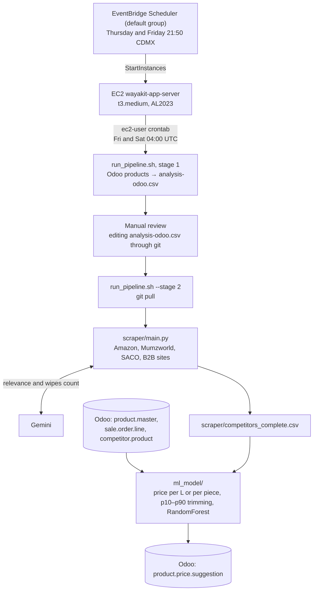

# Price Intelligence (PI)

Suggested prices for Wayakit's Saudi Arabia catalog. Competitor site scrapers → CSV → RandomForest model (scikit-learn) → `product.price.suggestion` in Odoo (previous suggestions are archived in `product.price.suggestion.history`). It runs on an EC2 in Wayakit's AWS account, region eu-north-1.

> **Odoo:** confirm the company (KSA or MX) before reading or writing. The reads **do not filter by company** (`ml_model/odoo_api_*.py`); the database is KSA only (Mafer, 2026-11-17). Since F2 the upload refuses to write if the Odoo user sees more than one company.

No credentials go in the repo, and no new CSVs or data are added: the only versioned CSVs are the 3 listed in "How to run it locally".

## Architecture today



- Each stage is a separate start-up, and when it finishes the instance stops itself (`trap EXIT`, `run_pipeline.sh:52`). They are launched by the `ec2-user` crontab (not in the repo): stage 1 on Friday 04:00 UTC and stage 2 on Saturday 04:00 UTC (Thursday and Friday 22:00 CDMX). Starting the instance at any other time launches nothing.
- The run is always full: since e25e2c9 partial mode (new products only, in append) is disabled (`run_pipeline.sh:67-68`), although its code is still in the script.
- All state (CSVs, `.joblib` models, logs and state files such as `last_full_run.txt`) lives only on the instance disk. Since F2, logs and state files go to one folder outside the code: `PI_LOG_DIR`, default `<repo>/../logs`. There is a manual snapshot from 2026-11-17 (`pi-f1-antes-inventario`).
- The instance runs the **`server-improvement`** branch (e25e2c9), one commit ahead of `main`.
- The last full run (13–15 Nov 2026) failed in scraping (30 h timeout, 53 rows) and still uploaded suggestions to Odoo: today they come almost only from `competitor.product`.

### F2 changes (in the code, not yet on the instance)

- Every pipeline step aborts the run if it fails (`|| exit 1`), and every script exits with code 1 on an error. Stage 2 no longer runs `git pull` (deploy by hand through SSM until F4) and no longer deletes `competitors_complete.csv`: the scraper replaces it only when it succeeds.
- Relevance with Amazon Bedrock (DeepSeek V3.2, fallback Claude Haiku 4.5) instead of Gemini, in batches, with the instance role. **It needs `bedrock:InvokeModel` on the instance role (F3) before it can run there.** The scraper writes a coverage report (`scraper/coverage_report.csv`).
- Safe upload to Odoo: `--dry-run`, create the new batch before deleting the previous one, `--cleanup-previous`, and a company guard.
- Sales from the last 12 rolling months; secrets read only through `pi_secrets.py`.

Details in [docs/runbook.md](docs/runbook.md) and [docs/decisions.md](docs/decisions.md).

## Target architecture

Except what is marked F2 (code only), none of this exists yet; no new resource has been created in AWS. Details in [docs/plan.md](docs/plan.md).

- **Planned (F6):** Amazon KSA and Noon KSA through Apify (`junglee/amazon-crawler` and `saswave/noon-product-scraper`), in VdC's Apify account. Mumzworld and SACO stay the same.
- **F2 (in the code):** relevance with Bedrock instead of Gemini: DeepSeek V3.2 as primary and Claude Haiku 4.5 as fallback, in batches and with the same `RelevanceAgent` interface. Needs the F3 permission to run on the instance.
- **Planned (F3):** a single monthly full run, on the last Thursday of each month. No stage 2 (`git pull` was already removed in F2); the search list comes from `modifiers_mapping.csv` through a PR (time, time zone and removing the manual review are still open in `docs/plan.md`, section 4).
- **Planned (F3):** state in S3 (`price-intelligence-<account>`) and resources in `infra/` (boto3 scripts with `--dry-run`, tag `project=price-intelligence`).
- **Planned (F4):** pull-on-boot CI/CD: GitHub Actions (OIDC) publishes the release to S3 and starts the instance in "deploy only" mode.
- **F2 (in the code):** safe upload to Odoo (`create` of the new batch and then `unlink` of the previous one), with `--dry-run` and a company guard.

## Structure

| Path | What it contains |
|---|---|
| `scraper/` | `main.py` (orchestrates the scraping), `config.py` (`TARGET_MAP`, CSV columns, exclusions), `odoo_api_connection_products.py` (generates `analysis-odoo.csv`), `modifiers_mapping.csv` (keywords per product type) |
| `scraper/scrapers/` | One scraper per site (Selenium + BeautifulSoup) with the signature `scrape(keyword, search_mode) -> list[dict]` (AeroSense uses `scrape(search_term, mode='volume')`, same argument order) |
| `scraper/services/` | `ai_service.py`: `RelevanceAgent` (Gemini on the instance today; Bedrock since F2) |
| `ml_model/` | Odoo reads, preprocessing (`1a`, `1b`), training (`2`), prediction (`3`) and upload (`odoo_api_price_suggestion.py`) |
| `docs/` | Plan, runbook, AWS inventory, decisions and reliability checklist |
| `run_pipeline.sh` | 2-stage pipeline that runs on the instance |
| `log_config.py` | Logging with rotation; writes `wayakit_app.log` to the log folder outside the repo (`PI_LOG_DIR`, default `../logs`) |
| `pi_secrets.py` | The only reader of the `prod/wayakit-app` secret (`get_secret()`, `get_odoo_credentials()`), since F2 |
| `pi_odoo.py` | Shared Odoo XML-RPC session (`connect()`, `OdooSession`, `get_single_company()`), since F2 |
| `requirements.txt` | Dependencies, without pinned versions |
| `infra/` | Planned (F3) |
| `tests/` | Tests without network: `unit/`, `property/` (Hypothesis), `e2e/` (ML stages and `run_pipeline.sh` in a temporary copy) and `differential/` (base branch against the new version). Run with `scripts/verify.sh quick\|full` |
| `scripts/` | `verify.sh`, `install_githooks.sh` (`commit-msg` hook for the `Verified:` stamp) and the Claude Code hooks (`hooks/`) |
| `.claude/` | Development team agents (`pi-dev`, `pi-tester`, `pi-reviewer`), skills `team` and `verify`, and `settings.json` with the hooks |
| `.github/workflows/` | Planned (F4): `ci.yml` and `deploy.yml` |

## Sources

Comes from `TARGET_MAP` (`scraper/config.py:9-24`). The channel is decided by `scraper/main.py:364-365`: B2C if the subindustry is Home, Automotive or Pets; B2B for all others.

| Site | Channel | Subindustries | Method today | Planned change |
|---|---|---|---|---|
| Amazon (amazon.sa) | B2C | Home, Automotive, Pets | Selenium + Gemini | Apify `junglee/amazon-crawler` (F6). Scope per subindustry pending |
| Noon (noon.com/saudi-en) | B2C | Does not exist today | — | Apify `saswave/noon-product-scraper` (F6). Subindustries pending |
| Mumzworld | B2C | Home | Selenium + Gemini | Same; only the AI changes to Bedrock (F2) |
| SACO (saco.sa) | B2C / B2B | Home, Automotive (B2C); Healthcare (B2B) | Selenium + Gemini | Same; only the AI changes to Bedrock (F2) |
| Fine (ksa.finestore.com) | B2B | Airports, Restaurants, Facilities management, Faith, Gyms, Land Transportation, Spas and salons, Hotels, Healthcare, Industrial facilities | Selenium + Gemini | AI to Bedrock (F2) |
| GoGreen (gogreen.com.sa) | B2B | Facilities management, Faith, Gyms, Land Transportation, Spas and salons, Hotels, Industrial facilities | Selenium + Gemini | AI to Bedrock (F2) |
| OfficeSupply (officesupply.sa) | B2B | Facilities management, Faith, Gyms, Spas and salons, Hotels, Industrial facilities | Selenium + Gemini | AI to Bedrock (F2) |
| AeroSense (aero-sense.com) | B2B | Aviation | Selenium, no AI filter | None |

Note: `Land Transportation` (`config.py:19`) does not match `Land transportation` in the CSV, so today that subindustry is never scraped.

## How to run it locally

Requirements: Python with `requirements.txt` and Chrome installed (`webdriver-manager` downloads the driver). [environment.yml](environment.yml) pins the instance versions (Python 3.10.20):

- **Local:** `conda env create -f environment.yml` creates the `wayakit-price-prediction` environment. For the tests, also `pip install -r requirements-dev.txt` and, once per clone, `scripts/install_githooks.sh`.
- **Instance:** the environment is still called `wayakit_env` until F3 (`run_pipeline.sh:6`). If it has to be recreated there: `conda env create -f environment.yml -n wayakit_env`; without `-n` it creates `wayakit-price-prediction` and the pipeline does not find it. The Odoo scripts read the `prod/wayakit-app` secret (eu-north-1) through `pi_secrets.py` with the default boto3 session, so you need an SSO profile with read permission on that secret. Since F2, `scraper/main.py` calls Bedrock with the same session (`bedrock:InvokeModel`).

The CSVs are not in git (except `scraper/analysis-odoo.csv`, `scraper/modifiers_mapping.csv` and `ml_model/wayakit_products_competition.csv`): they are generated when running. All commands run from the repo root.

```bash
aws sso login --profile <profile>
export AWS_PROFILE=<profile>
pip install -r requirements.txt
python ml_model/odoo_api_products.py                 # Odoo → ml_model/wayakit_products.csv
python scraper/odoo_api_connection_products.py       # → scraper/analysis-odoo.csv (overwrites a versioned file)
python scraper/main.py --analysis_file scraper/analysis-odoo.csv --output_file scraper/competitors_complete.csv
python ml_model/odoo_api_cotizations.py              # sales of the last 12 rolling months (since F2)
python ml_model/odoo_api_competitor_products.py
python ml_model/1a_preprocess_data.py
python ml_model/1b_preprocess_data.py --run_mode full
python ml_model/2_train_models.py                    # → ml_model/trained_models/*.joblib
python ml_model/3_predicted_prices.py                # → ml_model/wayakit_prediction_report.csv
python ml_model/odoo_api_price_suggestion.py --run_mode full --dry-run   # → ml_model/price_suggestion_dry_run.csv; no secrets, no Odoo
```

- Full scraping can take up to 30 h (`run_pipeline.sh:154`); for testing, use a trimmed `analysis-odoo.csv` and do not push it to git.
- **Do not run `ml_model/odoo_api_price_suggestion.py` locally without `--dry-run`.** It writes to production Odoo: with `--run_mode full` it creates the new suggestions and then archives and deletes the previous ones (since F2; before, it deleted first and an error left the table empty). Without arguments it runs in `partial` and only adds records. `--dry-run` reads no secrets and connects to nothing. Real uploads only with Mafer's OK and the KSA company confirmed.

## Documentation

- [CLAUDE.md](CLAUDE.md): rules and context for Claude Code
- [docs/runbook.md](docs/runbook.md): how to operate, run by hand, re-upload to Odoo and known issues
- [docs/resources.md](docs/resources.md): inventory of what exists in AWS
- [docs/decisions.md](docs/decisions.md): why it is the way it is
- [docs/plan.md](docs/plan.md): Nov–Dec 2026 improvement plan (phases F0–F8)
- [REVIEW.md](REVIEW.md) and [docs/reliability-checklist.md](docs/reliability-checklist.md): what blocks a commit and which checks to run depending on the diff (read from the base branch)
- Skills [`verify`](.claude/skills/verify/SKILL.md) (how to verify without touching production) and [`team`](.claude/skills/team/SKILL.md) (how the agent team works)
- Tickets: [A, fix Pets and migrate B2C to Apify](https://app.notion.com/p/41abe65f8c1381ffb1dad8a51e4eb87a) · [B, infrastructure as code and CI/CD to EC2](https://app.notion.com/p/41abe65f8c1381e88806e23603e434b3)
