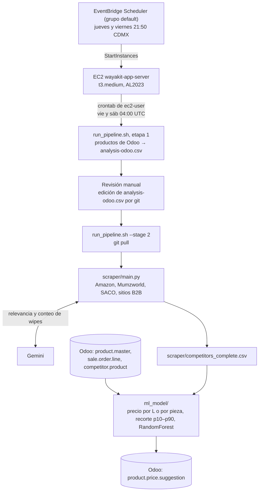

# Price Intelligence (PI)

Precios sugeridos para el catálogo de Wayakit en Arabia Saudita. Scrapers de sitios de competencia → CSV → modelo RandomForest (scikit-learn) → `product.price.suggestion` en Odoo (las sugerencias anteriores se archivan en `product.price.suggestion.history`). Corre en una EC2 de la cuenta AWS de Wayakit, región eu-north-1.

> **Odoo:** confirmar la compañía (KSA o MX) antes de leer o escribir. Hoy las consultas **no filtran por compañía** (`ml_model/odoo_api_*.py`); se asume KSA porque todo está en SAR. El filtro por compañía está Planeado (F2).

Ninguna credencial va en el repo, y no se agregan CSV ni datos nuevos: los únicos CSV versionados son los 3 que se listan en «Cómo correrlo en local».

## Arquitectura hoy



- Cada etapa es un encendido distinto y al terminar la instancia se apaga sola (`trap EXIT`, `run_pipeline.sh:52`). Las lanza el crontab de `ec2-user` (no está en el repo): etapa 1 el viernes 04:00 UTC y etapa 2 el sábado 04:00 UTC (jueves y viernes 22:00 CDMX). Encender la instancia a otra hora no lanza nada.
- La corrida es siempre completa: desde e25e2c9 el modo parcial (solo productos nuevos, en append) está deshabilitado (`run_pipeline.sh:67-68`), aunque su código sigue en el script.
- Todo el estado (CSV, modelos `.joblib`, `logs/last_full_run.txt`, logs) vive solo en el disco de la instancia. Hay un snapshot manual del 2026-11-17 (`pi-f1-antes-inventario`).
- La instancia corre la rama **`server-improvement`** (e25e2c9), un commit adelante de `main`.
- La última corrida completa (13–15 nov 2026) falló en el scraping (timeout de 30 h, 53 filas) y aun así subió sugerencias a Odoo: hoy salen casi solo de `competitor.product`.

## Arquitectura objetivo

Nada de esto existe todavía; en AWS no se ha creado ningún recurso nuevo. Detalle en [docs/plan.md](docs/plan.md).

- **Planeado (F6):** Amazon KSA y Noon KSA por Apify (`junglee/amazon-crawler` y `saswave/noon-product-scraper`), en la cuenta de Apify de VdC. Mumzworld y SACO se quedan igual.
- **Planeado (F2):** relevancia con Bedrock en lugar de Gemini: DeepSeek V3.2 como principal y Claude Haiku 4.5 como respaldo, por lotes y con la misma interfaz de `RelevanceAgent`.
- **Planeado (F2, F3):** una sola corrida mensual y completa, el último jueves de cada mes. Sin etapa 2 ni `git pull`; la lista de búsqueda sale de `modifiers_mapping.csv` por PR (hora, zona horaria y la eliminación de la revisión manual siguen abiertas en `docs/plan.md`, sección 4).
- **Planeado (F3):** estado en S3 (`price-intelligence-<cuenta>`) y recursos en `infra/` (scripts boto3 con `--dry-run`, etiqueta `project=price-intelligence`).
- **Planeado (F4):** CI/CD pull-on-boot: GitHub Actions (OIDC) publica el release en S3 y enciende la instancia en modo "solo deploy".
- **Planeado (F2):** subida segura a Odoo (`create` del lote nuevo y luego `unlink` del anterior), con `--dry-run` y filtro por compañía KSA.

## Estructura

| Ruta | Qué hay |
|---|---|
| `scraper/` | `main.py` (orquesta el scraping), `config.py` (`TARGET_MAP`, columnas del CSV, exclusiones), `odoo_api_connection_products.py` (genera `analysis-odoo.csv`), `modifiers_mapping.csv` (keywords por tipo de producto) |
| `scraper/scrapers/` | Un scraper por sitio (Selenium + BeautifulSoup) con la firma `scrape(keyword, search_mode) -> list[dict]` (AeroSense usa `scrape(search_term, mode='volume')`, mismo orden de argumentos) |
| `scraper/services/` | `ai_service.py`: `RelevanceAgent` (Gemini hoy) |
| `ml_model/` | Lecturas de Odoo, preprocesado (`1a`, `1b`), entrenamiento (`2`), predicción (`3`) y subida (`odoo_api_price_suggestion.py`) |
| `docs/` | Plan, runbook, inventario de AWS, decisiones y checklist de confiabilidad |
| `run_pipeline.sh` | Pipeline de 2 etapas que corre en la instancia |
| `log_config.py` | Logging con rotación; escribe en `../logs/wayakit_app.log`, fuera del repo (`log_config.py:7`) |
| `requirements.txt` | Dependencias, sin versiones fijas |
| `infra/` | Planeado (F3) |
| `tests/` | Pruebas sin red: `unit/`, `property/` (Hypothesis), `e2e/` (etapas del ML y `run_pipeline.sh` en una copia temporal) y `differential/` (rama base contra versión nueva). Se corren con `scripts/verify.sh rapido\|completo` |
| `scripts/` | `verify.sh`, `install_githooks.sh` (hook `commit-msg` del sello `Verificado:`) y los hooks de Claude Code (`hooks/`) |
| `.claude/` | Agentes del equipo de desarrollo (`pi-dev`, `pi-tester`, `pi-reviewer`), skills `equipo` y `verify`, y `settings.json` con los hooks |
| `.github/workflows/` | Planeado (F4): `ci.yml` y `deploy.yml` |

## Fuentes

Sale de `TARGET_MAP` (`scraper/config.py:9-24`). El canal lo decide `scraper/main.py:364-365`: B2C si la subindustria es Home, Automotive o Pets; B2B en las demás.

| Sitio | Canal | Subindustrias | Método hoy | Cambio planeado |
|---|---|---|---|---|
| Amazon (amazon.sa) | B2C | Home, Automotive, Pets | Selenium + Gemini | Apify `junglee/amazon-crawler` (F6). Alcance por subindustria pendiente |
| Noon (noon.com/saudi-en) | B2C | No existe hoy | — | Apify `saswave/noon-product-scraper` (F6). Subindustrias pendientes |
| Mumzworld | B2C | Home | Selenium + Gemini | Igual; solo cambia la IA a Bedrock (F2) |
| SACO (saco.sa) | B2C / B2B | Home, Automotive (B2C); Healthcare (B2B) | Selenium + Gemini | Igual; solo cambia la IA a Bedrock (F2) |
| Fine (ksa.finestore.com) | B2B | Airports, Restaurants, Facilities management, Faith, Gyms, Land Transportation, Spas and salons, Hotels, Healthcare, Industrial facilities | Selenium + Gemini | IA a Bedrock (F2) |
| GoGreen (gogreen.com.sa) | B2B | Facilities management, Faith, Gyms, Land Transportation, Spas and salons, Hotels, Industrial facilities | Selenium + Gemini | IA a Bedrock (F2) |
| OfficeSupply (officesupply.sa) | B2B | Facilities management, Faith, Gyms, Spas and salons, Hotels, Industrial facilities | Selenium + Gemini | IA a Bedrock (F2) |
| AeroSense (aero-sense.com) | B2B | Aviation | Selenium, sin filtro de IA | Ninguno |

Ojo: `Land Transportation` (`config.py:19`) no coincide con `Land transportation` del CSV, así que hoy esa subindustria nunca se scrapea.

## Cómo correrlo en local

Requisitos: Python con `requirements.txt` y Chrome instalado (`webdriver-manager` descarga el driver). [environment.yml](environment.yml) fija las versiones de la instancia (Python 3.10.20):

- **Local:** `conda env create -f environment.yml` crea el entorno `wayakit-price-prediction`. Para las pruebas, además `pip install -r requirements-dev.txt` y, una vez por clon, `scripts/install_githooks.sh`.
- **Instancia:** el entorno sigue llamándose `wayakit_env` hasta F3 (`run_pipeline.sh:6`). Si hay que recrearlo allí: `conda env create -f environment.yml -n wayakit_env`; sin `-n` se crea `wayakit-price-prediction` y el pipeline no lo encuentra. Los scripts leen el secreto `prod/wayakit-app` (eu-north-1) con la sesión por defecto de boto3, así que necesitas un perfil SSO con permiso de lectura sobre ese secreto.

Los CSV no están en git (salvo `scraper/analysis-odoo.csv`, `scraper/modifiers_mapping.csv` y `ml_model/wayakit_products_competition.csv`): se generan al correr. Todos los comandos van desde la raíz del repo.

```bash
aws sso login --profile <perfil>
export AWS_PROFILE=<perfil>
pip install -r requirements.txt
python ml_model/odoo_api_products.py                 # Odoo → ml_model/wayakit_products.csv
python scraper/odoo_api_connection_products.py       # → scraper/analysis-odoo.csv (sobrescribe un archivo versionado)
python scraper/main.py --analysis_file scraper/analysis-odoo.csv --output_file scraper/competitors_complete.csv
python ml_model/odoo_api_cotizations.py              # ventas fijas a 2025 (odoo_api_cotizations.py:75-76)
python ml_model/odoo_api_competitor_products.py
python ml_model/1a_preprocess_data.py
python ml_model/1b_preprocess_data.py --run_mode full
python ml_model/2_train_models.py                    # → ml_model/trained_models/*.joblib
python ml_model/3_predicted_prices.py                # → ml_model/wayakit_prediction_report.csv
```

- El scraping completo puede tardar hasta 30 h (`run_pipeline.sh:154`); para probar, usa un `analysis-odoo.csv` recortado y no lo subas a git.
- **No corras `ml_model/odoo_api_price_suggestion.py` en local.** Escribe en Odoo de producción: con `--run_mode full` copia todas las sugerencias a `product.price.suggestion.history`, las borra (`unlink`) y crea las nuevas; si el `create` falla, la tabla queda vacía. Sin argumentos corre en `partial` y solo agrega registros. No tiene `--dry-run` (Planeado, F2). Solo con OK de Mafer y la compañía KSA confirmada.

## Documentación

- [CLAUDE.md](CLAUDE.md): reglas y contexto para Claude Code
- [docs/runbook.md](docs/runbook.md): cómo operar, correr a mano, volver a subir a Odoo y problemas conocidos
- [docs/recursos.md](docs/recursos.md): inventario de lo que existe en AWS
- [docs/decisiones.md](docs/decisiones.md): por qué está así
- [docs/plan.md](docs/plan.md): plan de mejoras nov–dic 2026 (fases F0–F8)
- [REVIEW.md](REVIEW.md) y [docs/checklist-confiabilidad.md](docs/checklist-confiabilidad.md): qué bloquea un commit y qué chequeos correr según el diff (se leen desde la rama base)
- Skills [`verify`](.claude/skills/verify/SKILL.md) (cómo verificar sin tocar producción) y [`equipo`](.claude/skills/equipo/SKILL.md) (cómo trabaja el equipo de agentes)
- Tickets: [A, corregir mascotas y migrar B2C a Apify](https://app.notion.com/p/41abe65f8c1381ffb1dad8a51e4eb87a) · [B, infraestructura como código y CI/CD a EC2](https://app.notion.com/p/41abe65f8c1381e88806e23603e434b3)
